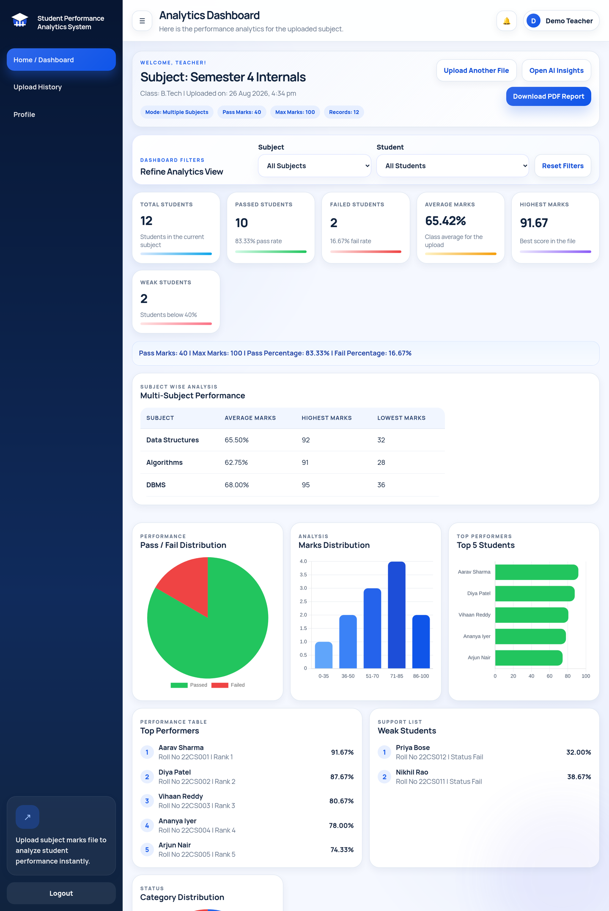

# Student Performance Analytics System

A full-stack web application for teachers to upload student marks, validate files, generate accurate analytics, ask data-based questions, and export reports.


---

## Contents

- [Overview](#overview)
- [Key Features](#key-features)
- [Screenshots](#screenshots)
- [System Architecture](#system-architecture)
  - [Runtime Flow](#runtime-flow)
- [Tech Stack](#tech-stack)
  - [Frontend](#frontend)
  - [Backend](#backend)
  - [Database](#database)
- [Project Structure](#project-structure)
- [Getting Started](#getting-started)
  - [Prerequisites](#prerequisites)
  - [Installation](#installation)
  - [Environment Setup](#environment-setup)
  - [Run Locally](#run-locally)
- [Configuration](#configuration)
- [Available Scripts](#available-scripts)
- [API Reference](#api-reference)
- [Upload File Requirements](#upload-file-requirements)
  - [Single Subject](#single-subject)
  - [Multi Subject](#multi-subject)
  - [Validation Rules](#validation-rules)
- [Analytics Provided](#analytics-provided)
- [AI Insights and Query Rules](#ai-insights-and-query-rules)
- [Security Notes](#security-notes)
- [Testing](#testing)
- [Documentation](#documentation)
- [Current Version](#current-version)
- [License](#license)

---

## Overview

Student Performance Analytics System helps teachers convert raw marks files into a structured performance dashboard. The application supports single-subject and multi-subject uploads, validates file contents before analysis, stores processed records in MongoDB, and provides charts, summaries, student rankings, weak-student identification, AI-assisted insights, and downloadable reports.

The current project is a local full-stack setup: the Express backend serves both the API and the frontend. There is no active deployment workflow or hosted-backend adapter in the current version.

---

## Key Features

- Secure teacher signup and login using bcrypt password hashing and JWT authentication.
- CSV, Excel, and text-based PDF upload support with file signature validation.
- Single-subject and multi-subject marks processing.
- Row-level validation for missing names, invalid roll numbers, duplicate roll numbers, negative marks, non-numeric marks, and marks exceeding maximum marks.
- Automatic analytics generation with total students, pass/fail counts, averages, highest/lowest marks, distribution bands, rankings, and categories.
- Interactive dashboard with charts, filters, searchable student table, and upload history.
- Data-grounded AI insights and Q&A with safe fallback when no optional AI key is configured.
- Downloadable PDF, Excel, and CSV reports.
- MongoDB persistence for users, uploads, students, analytics, insights, and report history.

---

## Screenshots

| Login | Upload |
|---|---|
|  |  |

| Dashboard | AI Insights |
|---|---|
|  |  |


---

## System Architecture


### Runtime Flow

1. Teacher opens the frontend at `http://localhost:3000`.
2. Express serves the static frontend from `frontend/`.
3. Frontend calls backend API routes under `/api/*`.
4. Backend validates authentication, uploaded files, and marks data.
5. Clean records and analytics are stored in MongoDB.
6. Dashboard, insights, reports, and history are loaded from stored data.
7. Groq AI is optional; local deterministic/template fallback keeps the app functional without an API key.

---

## Tech Stack

### Frontend

- HTML5
- CSS3
- JavaScript ES modules
- Chart.js
- Responsive light-mode UI

### Backend

- Node.js
- Express 5
- MongoDB native driver
- JWT authentication
- bcryptjs
- multer
- csv-parser
- xlsx
- pdf-parse
- pdfkit
- Groq SDK, optional

### Database

- MongoDB local or MongoDB Atlas
- Indexed collections for efficient lookup by user and upload

---

## Project Structure

```
Student Analytics Performance System/
├── backend/
│   ├── index.js                         Express startup, middleware, routes, static frontend serving
│   ├── package.json                     backend scripts and dependencies
│   ├── package-lock.json                locked dependency versions
│   ├── .env.example                     environment template without real secrets
│   ├── src/
│   │   ├── config/env.js                environment loading and validation
│   │   ├── db/connection.js             MongoDB connection, indexes, demo seeding
│   │   ├── middleware/                  auth, CORS, rate limits, security, upload handling
│   │   ├── routes/                      health, auth, upload, analytics, students, AI, reports, uploads
│   │   ├── services/                    parsing, validation, analytics, query engine, AI, reports
│   │   └── utils/                       shared helpers and normalizers
│   └── tests/                           Node test suite
├── frontend/
│   ├── index.html                       single-page application shell
│   ├── style.css                        UI styling
│   ├── script.js                        frontend entry point
│   ├── site-config.js                   optional API base URL override
│   ├── intro.jpeg                       login page background image
│   └── src/
│       ├── api/                         API config and request client
│       ├── charts/                      Chart rendering helpers
│       ├── pages/                       page modules for upload, dashboard, insights, history, profile
│       ├── utils/                       formatting helpers
│       ├── constants.js                 shared constants
│       ├── data.js                      client-side data helpers
│       ├── dom.js                       DOM utilities
│       ├── selectors.js                 shared DOM selectors
│       ├── shell.js                     app shell and navigation
│       └── state.js                     client state
├── docs/
│   ├── SRS.md                           software requirements specification
│   ├── diagrams/                        architecture, ER, use-case, and sequence diagrams
│   └── screenshots/                     README screenshots
├── eslint.config.mjs                    lint configuration
├── .gitignore                           ignored secrets, dependencies, and runtime data
├── LICENSE                              MIT license
└── README.md                            project documentation
```

Ignored runtime folders/files such as `backend/.env`, `backend/node_modules/`, `backend/.mongodb-data/`, and `.dist/` are not part of the committed source structure.

---

## Getting Started

### Prerequisites

- Node.js 18 or newer
- MongoDB 5.0 or newer, or MongoDB Atlas
- Git

### Installation

```bash
git clone https://github.com/varshithvardhan2006-09/Student-Performance-Analytics-System.git
cd "Student Analytics Performance System/backend"
npm install
```

### Environment Setup

Copy the example file and create your local environment file:

```bash
cp .env.example .env
```

Update `backend/.env` with your own values. At minimum, set a strong `JWT_SECRET`.

Generate a secure JWT secret:

```bash
node -e "console.log(require('crypto').randomBytes(48).toString('hex'))"
```

`GROQ_API_KEY` is optional. If it is empty, the app still works using local fallback insights.

### Run Locally

```bash
npm start
```

Open:

```text
http://localhost:3000
```

---

## Configuration

| Variable | Required | Purpose |
|---|:---:|---|
| `PORT` | No | Backend server port, default `3000` |
| `MONGODB_URI` | No | MongoDB connection string |
| `MONGODB_DB` | No | MongoDB database name |
| `MONGODB_USERS_COLLECTION` | No | Users collection name |
| `MONGODB_TIMEOUT_MS` | No | MongoDB connection timeout |
| `JWT_SECRET` | Yes | Secret key used to sign JWT tokens |
| `GROQ_API_KEY` | No | Enables optional AI-generated insights |
| `ALLOWED_ORIGINS` | Production | Comma-separated allowed browser origins |
| `FRONTEND_URL` | No | Additional frontend origin for CORS |
| `JSON_LIMIT` | No | Maximum JSON request body size |
| `DEMO_TEACHER_*` | No | Optional seeded teacher values for local demos |

Never commit `backend/.env` or real API keys.

---

## Available Scripts

Run these from the `backend/` folder.

| Command | Purpose |
|---|---|
| `npm start` | Start the backend and serve the frontend |
| `npm run dev` | Start with nodemon during development |
| `npm test` | Run the Node test suite |
| `npm run test:syntax` | Syntax-check backend and frontend entry files |
| `npm run lint` | Run ESLint on backend and frontend |
| `npm run lint:fix` | Auto-fix supported lint issues |

---

## API Reference

All protected routes require a JWT token in the `Authorization` header:

```text
Authorization: Bearer <token>
```

| Method | Route | Auth | Purpose |
|---|---|:---:|---|
| `GET` | `/api/health` | No | Server, database, and AI status |
| `POST` | `/api/signup` | No | Register a teacher account |
| `POST` | `/api/login` | No | Login and receive JWT token |
| `GET` | `/api/profile` | Yes | Get current teacher profile |
| `GET` | `/api/profile/stats` | Yes | Get account statistics |
| `POST` | `/api/upload` | Yes | Upload and process marks file |
| `GET` | `/api/analytics/:uploadId` | Yes | Get stored analytics |
| `GET` | `/api/analytics/:uploadId/filtered` | Yes | Get filtered dashboard analytics |
| `GET` | `/api/students/:uploadId` | Yes | Get students for an upload |
| `POST` | `/api/ai-insights/:uploadId` | Yes | Generate AI/fallback insights |
| `GET` | `/api/ai-insights/:uploadId` | Yes | Get saved insights |
| `POST` | `/api/ai-query/:uploadId` | Yes | Ask a data-related question |
| `GET` | `/api/reports/:uploadId/pdf` | Yes | Download PDF report |
| `GET` | `/api/reports/:uploadId/excel` | Yes | Download Excel report |
| `GET` | `/api/reports/:uploadId/csv` | Yes | Download CSV report |
| `GET` | `/api/uploads` | Yes | List upload history |
| `GET` | `/api/uploads/:id` | Yes | Get upload details |
| `DELETE` | `/api/uploads/:id` | Yes | Delete upload and related records |

---

## Upload File Requirements

### Single Subject

Required columns:

- Roll No
- Student Name
- Marks

### Multi Subject

Required columns:

- Roll No
- Student Name
- One or more numeric subject columns

### Validation Rules

- File must be CSV, Excel, or supported text-based PDF.
- File must not be empty.
- Required columns must be present.
- Roll numbers must be unique.
- Marks must be numeric.
- Marks cannot be negative.
- Marks cannot exceed maximum marks.

---

## Analytics Provided

- Total students
- Passed students
- Failed students
- Pass percentage
- Fail percentage
- Average marks
- Highest marks
- Lowest marks
- Marks distribution
- Top performers
- Weak students
- Student ranking
- Performance category
- Subject-wise summary for multi-subject files

---

## AI Insights and Query Rules

The app is designed to answer questions only about the uploaded student data.

- Data-related questions are answered using stored analytics and student records.
- Unrelated questions are rejected with a message asking the user to ask about uploaded data.
- Mixed questions are handled safely by focusing only on the data-related part.
- If the optional AI key is missing, local fallback summaries are used.

---

## Security Notes

- Passwords are hashed using bcrypt.
- JWT is used for authenticated sessions.
- Auth and upload routes are rate-limited.
- Uploaded files are checked by extension and byte signature.
- Original uploaded files are processed in memory and are not stored as permanent files.
- `.env` files are ignored by Git.
- CORS is controlled by configuration.

---

## Testing

```bash
cd backend
npm run test:syntax
npm run lint
npm test
```

The current codebase includes automated tests for validation, parsing, analytics, query handling, security helpers, and route-related behavior.

---

## Documentation

| File | Description |
|---|---|
| `docs/SRS.md` | Software requirements specification |
| `docs/diagrams/architecture.svg` | Current local system architecture |
| `docs/diagrams/er-diagram.svg` | Entity relationship diagram |
| `docs/diagrams/use-case.svg` | Use case diagram |
| `docs/diagrams/sequence-upload.svg` | Upload processing sequence |

Mermaid source files are available beside the exported diagrams.

---

## Current Version

```text
2.0.1
```

---

## License

This project is licensed under the MIT License.

© 2026 Varshith Vardhan Chiluveru
