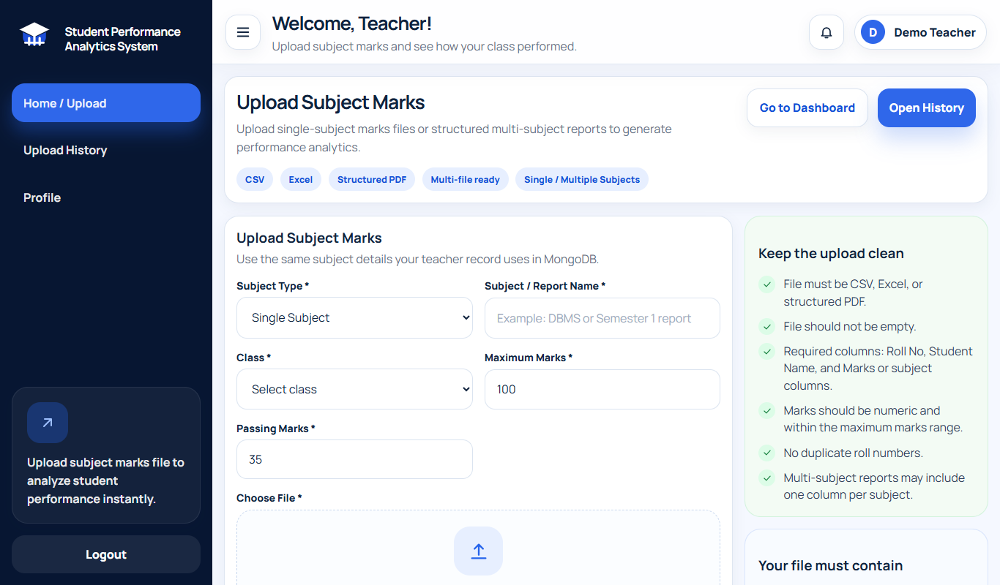
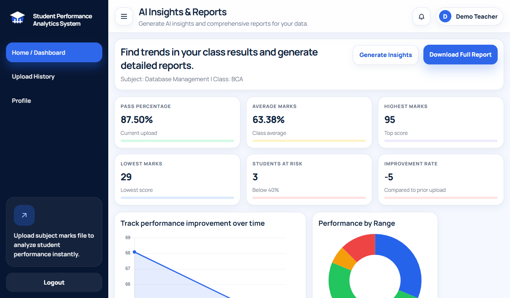
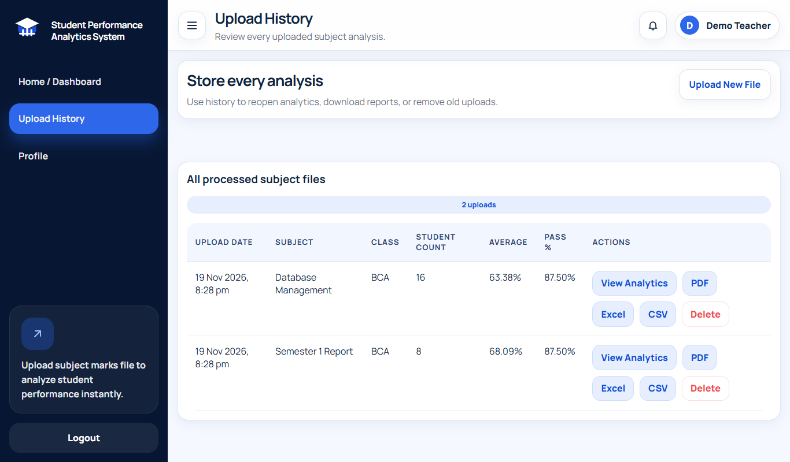
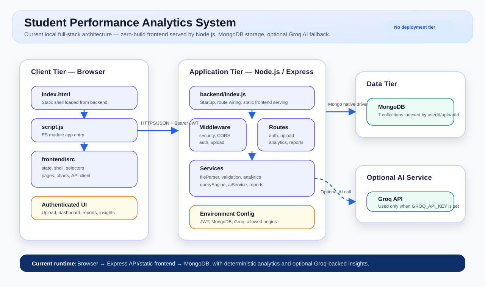

# Student Performance Analytics System

A full-stack web application for teachers to upload student marks, validate the files, see analytics on a dashboard, ask questions about the data, and export reports.


---

## Contents

- [Overview](#overview)
- [Presentation](#presentation)
- [Screenshots](#screenshots)
- [Features](#features)
- [Architecture](#architecture)
- [Dataset](#dataset)
- [Data sources](#data-sources)
- [Tech stack](#tech-stack)
- [Run locally](#run-locally)
- [API & AI & ML & NLP](#api--ai--ml--nlp)
- [Security](#security)
- [Privacy](#privacy)
- [Future enhancements](#future-enhancements)
- [Author](#author)
- [License](#license)

---

## Overview

Teachers usually keep marks in spreadsheets. This project turns a marks file into a performance dashboard: pass and fail counts, averages, rankings, weak students, subject-wise results and downloadable reports.

A teacher signs up, uploads a CSV, Excel or text-based PDF file for one subject or for several subjects at once, and the server checks every row before anything is saved. The results are stored in MongoDB, so earlier uploads can be reopened from the history page. The Express server serves both the API and the frontend, so the whole project runs from one command.

---

## Presentation

There is no slide deck in this repository. The project is presented through its documents:

| Document | What it covers |
|---|---|
| [`docs/SRS.md`](docs/SRS.md) | Software requirements specification: scope, users, requirements, data model |
| [`docs/diagrams/architecture.svg`](docs/diagrams/architecture.svg) | System architecture |
| [`docs/diagrams/use-case.svg`](docs/diagrams/use-case.svg) | Use case diagram |
| [`docs/diagrams/er-diagram.svg`](docs/diagrams/er-diagram.svg) | Entity relationship diagram |
| [`docs/diagrams/sequence-upload.svg`](docs/diagrams/sequence-upload.svg) | What happens when a file is uploaded |

Each diagram also has a Mermaid source file (`.mmd`) and a PNG export in the same folder.

---

## Screenshots

Captured from the live app running locally with the sample files in [`docs/sample-data`](docs/sample-data).

| Login | Upload |
|---|---|
|  |  |

| Dashboard | AI Insights |
|---|---|
|  |  |



---

## Features

- Teacher signup and login with bcrypt password hashing and JWT sessions.
- CSV, Excel (`.xlsx`, `.xls`) and text-based PDF uploads, up to 10 MB per file, with file signature checks.
- Single-subject and multi-subject marks files, and several files in one upload.
- Row-level validation: missing columns, duplicate roll numbers, non-numeric marks, negative marks and marks above the maximum. Errors name the row.
- Analytics: total, passed and failed students, pass percentage, average, highest and lowest marks, mark distribution bands, ranking, performance categories and a subject-wise summary.
- Dashboard with charts, subject and student filters and a searchable student table.
- Questions about the uploaded data in plain English, answered from the stored records.
- AI insights with a built-in fallback when no AI key is configured.
- PDF, Excel and CSV report downloads.
- Upload history with reopen and delete.
- Privacy policy and terms pages linked from every screen.

---

## Architecture



1. The teacher opens `http://localhost:3000`. Express serves the static frontend from `frontend/`.
2. The frontend calls the API under `/api/*` with a JWT in the `Authorization` header.
3. The backend checks the token, the uploaded file and every record.
4. Clean records and calculated analytics are saved to MongoDB.
5. The dashboard, insights, reports and history read from the stored data.
6. Groq is optional. Without a key, the local fallback keeps everything working.

```
Student-Performance-Analytics-System/
├── .github/workflows/ci.yml            lint and tests on every push
├── .vscode/                            shared editor, debug and task settings
├── backend/
│   ├── index.js                        Express startup, middleware, routes, static files
│   ├── package.json
│   ├── .env.example                    environment template (no secrets)
│   ├── src/
│   │   ├── config/env.js               environment loading and validation
│   │   ├── db/connection.js            MongoDB connection, indexes, demo user
│   │   ├── middleware/                 auth, CORS, rate limits, security headers, uploads
│   │   ├── routes/                     health, auth, upload, analytics, students, AI, reports, uploads
│   │   ├── services/                   parsing, validation, analytics, query engine, AI
│   │   └── utils/                      validators and normalizers
│   └── tests/                          Node test suite
├── frontend/
│   ├── index.html                      single-page app shell
│   ├── privacy.html, terms.html        policy pages
│   ├── style.css, script.js, favicon.svg
│   └── src/                            api, charts, pages, utils, state, shell, selectors
├── docs/                               SRS, diagrams, screenshots, sample data
├── eslint.config.mjs
└── LICENSE
```

---

## Dataset

The project does not ship a fixed dataset. Each teacher brings their own marks file, and the sample files in [`docs/sample-data`](docs/sample-data) show the expected shape. They contain made-up placeholder names, not real students.

**Single subject** ([`single-subject.csv`](docs/sample-data/single-subject.csv)): columns `Roll No`, `Student Name`, `Marks`.

**Multiple subjects** ([`multi-subject.csv`](docs/sample-data/multi-subject.csv)): `Roll No`, `Student Name`, then one numeric column per subject.

Column names are matched loosely, so `Roll`, `Name` or `Score` also work.

**Rules applied to every file**

- The file must not be empty and the required columns must be present.
- Roll numbers must be unique.
- Marks must be numbers between 0 and the maximum marks entered on the upload form.
- Passing marks must be above 0 and not above the maximum marks.

**How results are decided**

- Single subject: a student passes with marks at or above the passing marks.
- Multiple subjects: a student passes only by reaching the passing marks in every subject. The student's overall mark is the average of the subjects.
- Categories: Failed, Top Performer (above 80%), Weak Student (passed but below 40%) and Average Performer.

**What is stored** (see the ER diagram): `users`, `subjects`, `uploads`, `students`, `analytics`, `aiInsights` and `reports`.

---

## Data sources

- **Marks files uploaded by the teacher** (CSV, Excel, PDF). This is the only source of student data. Files are read in memory and are not kept on disk.
- **MongoDB**, running locally or on Atlas, holds the processed records.
- **Groq** (optional) receives summary figures for insights, a question when the built-in engine cannot answer it, and the text of an uploaded PDF. It is only used when `GROQ_API_KEY` is set.

No external datasets, scraped data or third-party student data are used.

---

## Tech stack

**Frontend:** HTML5, CSS3, JavaScript ES modules, Chart.js 4.4.7 (loaded from jsDelivr with an integrity hash).

**Backend:** Node.js 18+, Express 5, MongoDB native driver, jsonwebtoken, bcryptjs, multer, csv-parser, xlsx (SheetJS), pdf-parse, pdfkit and the Groq SDK.

**Database:** MongoDB 5 or newer, local or Atlas.

**Tooling:** ESLint 9, the built-in `node --test` runner, GitHub Actions.

---

## Run locally

**Requirements:** Node.js 18 or newer, MongoDB 5 or newer (or an Atlas connection string) and Git.

```bash
git clone https://github.com/varshithvardhan2006-09/Student-Performance-Analytics-System.git
cd Student-Performance-Analytics-System/backend
npm install
cp .env.example .env
```

Open `backend/.env` and set `JWT_SECRET` to a long random value:

```bash
node -e "console.log(require('crypto').randomBytes(48).toString('hex'))"
```

Start the app and open `http://localhost:3000`:

```bash
npm start
```

If MongoDB is installed locally but not running, the server tries to start it for you in development.

For local demos a teacher account is created automatically (`demo.teacher@saps.local`, password from `DEMO_TEACHER_PASSWORD`). It is never created when `NODE_ENV=production`.

**Environment variables**

| Variable | Required | Purpose |
|---|:---:|---|
| `JWT_SECRET` | Yes | Secret used to sign login tokens. Use 32 or more random characters |
| `PORT` | No | Server port, default `3000` |
| `MONGODB_URI` | No | MongoDB connection string, default `mongodb://127.0.0.1:27017` |
| `MONGODB_DB` | No | Database name, default `student_analytics` |
| `MONGODB_USERS_COLLECTION` | No | Users collection name |
| `MONGODB_TIMEOUT_MS` | No | Connection timeout |
| `GROQ_API_KEY` | No | Turns on AI-written insights |
| `ALLOWED_ORIGINS` | Production | Comma-separated browser origins allowed by CORS |
| `FRONTEND_URL` | No | One more allowed origin |
| `JSON_LIMIT` | No | Maximum JSON body size, default `2mb` |
| `TRUST_PROXY` | No | Number of reverse proxies in front of the app, so rate limiting sees real client IPs |
| `DEMO_TEACHER_*` | No | Name, email and password of the local demo account |

Never commit `backend/.env`.

**Scripts** (run from `backend/`)

| Command | Purpose |
|---|---|
| `npm start` | Start the server and serve the frontend |
| `npm run dev` | Start with nodemon |
| `npm test` | Run the tests |
| `npm run test:syntax` | Syntax check of the entry files |
| `npm run lint` | ESLint for backend and frontend |
| `npm run lint:fix` | Fix what ESLint can fix |

There is no build step. The frontend is served as it is.

---

## API & AI & ML & NLP

### API

Protected routes need `Authorization: Bearer <token>`.

| Method | Route | Auth | Purpose |
|---|---|:---:|---|
| `GET` | `/api/health` | No | Server and database status |
| `POST` | `/api/signup` | No | Register a teacher |
| `POST` | `/api/login` | No | Log in and receive a token |
| `GET` | `/api/profile` | Yes | Current teacher |
| `GET` | `/api/profile/stats` | Yes | Upload and report counts |
| `POST` | `/api/upload` | Yes | Upload and process marks files |
| `GET` | `/api/analytics/:uploadId` | Yes | Stored analytics |
| `GET` | `/api/analytics/:uploadId/filtered` | Yes | Analytics for a subject or student (`?subject=`, `?student=`) |
| `GET` | `/api/students/:uploadId` | Yes | Students, with search, status, category and paging |
| `POST` | `/api/ai-insights/:uploadId` | Yes | Generate insights |
| `GET` | `/api/ai-insights/:uploadId` | Yes | Saved insights, or `null` if none yet |
| `POST` | `/api/ai-query/:uploadId` | Yes | Ask a question about the data |
| `GET` | `/api/reports/:uploadId/pdf` | Yes | PDF report |
| `GET` | `/api/reports/:uploadId/excel` | Yes | Excel report |
| `GET` | `/api/reports/:uploadId/csv` | Yes | CSV report |
| `GET` | `/api/uploads` | Yes | Upload history (paged) |
| `GET` | `/api/uploads/:id` | Yes | One upload with its analytics |
| `DELETE` | `/api/uploads/:id` | Yes | Delete an upload and everything linked to it |

Errors come back as `{ "success": false, "message": "..." }` with a matching status code. Upload validation errors also include an `errors` list.

### AI

- Insights use Groq (`llama-3.1-8b-instant`) when `GROQ_API_KEY` is set and fall back to template-written insights if the key is missing or the call fails.
- Groq can also read the text of an uploaded PDF and help turn it into rows. If it fails, the local PDF parser is used.
- Only summary statistics and the question are sent for insights. Questions are cleaned before they go into a prompt, and the model is told to answer only from the supplied data.

### ML

There is no machine learning model in this project. Results come from fixed rules: percentages, pass and fail by the passing marks, categories by percentage bands, and ranking by marks.

### NLP

Questions are answered by a rule-based engine in `backend/src/services/queryEngine.js`, with no AI call. It understands things like "how many students failed", "who is the topper", "average in Physics", "between 40 and 60", "above 75 percent" and a student's name or roll number. Only questions it cannot answer go to Groq, and clearly off-topic questions are refused.

---

## Security

- Passwords are hashed with bcrypt (12 rounds). Signup requires 8 to 72 bytes.
- Login uses signed JWTs that expire after 7 days. Every query is limited to the logged-in teacher's own data.
- The server refuses to start in production without a strong `JWT_SECRET`.
- Login, signup and upload routes are rate limited. The limiter uses the real connection address and only trusts forwarded headers when `TRUST_PROXY` is set.
- Uploads are checked by extension and by file signature, limited to 10 MB, and kept in memory.
- The student search is treated as plain text, not a pattern.
- Security headers are sent on every response, including a Content-Security-Policy.
- CORS only allows the origins in your configuration.
- Chart.js is pinned and loaded with a Subresource Integrity hash.
- Dependencies are checked with `npm audit`, which currently reports no known vulnerabilities.
- `.env` files are ignored by Git.

---

## Privacy

The app stores teacher names, email addresses, password hashes, the marks data teachers upload, the analytics calculated from it, saved insights and a record of report downloads. Uploaded files themselves are not stored. Teachers can only see their own data, and deleting an upload removes everything linked to it. If Groq is configured, summary figures, questions and PDF text are sent to Groq to produce answers. See [`frontend/privacy.html`](frontend/privacy.html) and [`frontend/terms.html`](frontend/terms.html), which are also linked from the footer of the app.

---

## Future enhancements

- Let teachers choose how multi-subject pass or fail is decided (every subject, or the average).
- Email verification and a password reset flow.
- Refresh tokens and a way to sign out everywhere.
- A shared rate limit store so the app can run on more than one server.
- Tests for the frontend and for more API routes against a test database.
- Better PDF reading for scanned or complex layouts.
- Compare several uploads of the same class over time.
- A Docker setup for easier installs.

---

## Author

Varshith Vardhan Chiluveru, [varshithvardhan2006-09](https://github.com/varshithvardhan2006-09).

---

## License

Released under the [MIT License](LICENSE). © 2026 Varshith Vardhan Chiluveru.
